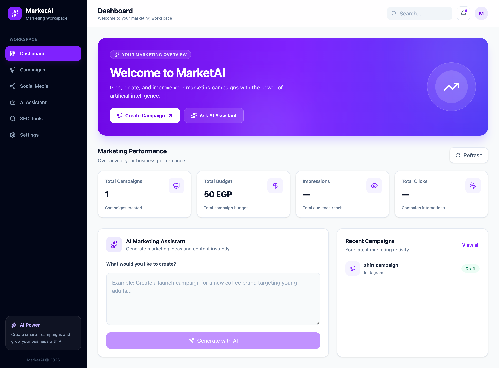

# MarketAI – AI-Powered Digital Marketing Platform

MarketAI is an AI-powered digital marketing platform designed to help businesses simplify their marketing workflows, create engaging content, manage campaigns, and improve their online presence.

Built with **React, Vite, Python, FastAPI, and AI integration**, MarketAI provides a centralized dashboard for managing digital marketing activities.

## 🚀 Features

- **Dashboard:** Monitor campaign statistics, budgets, impressions, clicks, and conversions.
- **Campaign Management:** Create, view, update, and delete marketing campaigns.
- **AI Content Generator:** Generate professional marketing content using AI.
- **AI Marketing Assistant:** Interact with an AI assistant and save chat history.
- **Social Media Generator:** Generate platform-specific captions, hashtags, and calls to action.
- **SEO Assistant:** Analyze keywords and topics and receive SEO recommendations.
- **Settings:** Configure business information, target audience, brand tone, and language.

## 🛠️ Tech Stack

### Frontend
- React 19
- Vite
- JavaScript
- React Router
- Tailwind CSS
- Lucide React
- Fetch API

### Backend
- Python
- FastAPI
- SQLAlchemy
- SQLite
- Pydantic
- Groq AI API

## 📁 Project Structure

```text
MarketAI/
│
├── backend/
│   ├── app/
│   │   ├── services/
│   │   │   └── ai_service.py
│   │   ├── database.py
│   │   ├── main.py
│   │   ├── models.py
│   │   └── schemas.py
│   │
│   ├── .env.example
│   └── requirements.txt
│
├── frontend/
│   ├── src/
│   │   ├── components/
│   │   ├── pages/
│   │   ├── services/
│   │   ├── App.jsx
│   │   ├── index.css
│   │   └── main.jsx
│   │
│   ├── .env.example
│   ├── package.json
│   └── vite.config.js
│
├── photos/
├── .gitignore
└── README.md
```

## ⚙️ Installation & Setup

### 1. Clone the Repository

```bash
git clone https://github.com/diaamohamed26/MarketAI_react_python.git

cd MarketAI_react_python
```

### 2. Backend Setup

Navigate to the backend folder:

```bash
cd backend
```

Create a Python virtual environment:

```bash
python3 -m venv venv
```

Activate it:

```bash
source venv/bin/activate
```

Install dependencies:

```bash
pip install -r requirements.txt
```

Create your environment file:

```bash
cp .env.example .env
```

Configure your `backend/.env`:

```env
GROQ_API_KEY=your_groq_api_key
GROQ_MODEL=your_model_name
```

Start the FastAPI server:

```bash
uvicorn app.main:app --reload
```

Backend URL:

`http://127.0.0.1:8000`

API Documentation:

`http://127.0.0.1:8000/docs`

### 3. Frontend Setup

Open a new terminal and navigate to the frontend folder:

```bash
cd frontend
```

Install dependencies:

```bash
npm install
```

Create the frontend environment file:

```bash
cp .env.example .env
```

Configure `frontend/.env`:

```env
VITE_API_URL=http://127.0.0.1:8000/api
```

Start the development server:

```bash
npm run dev
```

Frontend URL:

`http://localhost:5173`

## 🔗 API Endpoints

| Method | Endpoint | Description |
|---|---|---|
| GET | `/api/health/` | API health check |
| GET | `/api/dashboard/` | Dashboard statistics |
| GET | `/api/campaigns/` | Get campaigns |
| POST | `/api/campaigns/` | Create campaign |
| PATCH | `/api/campaigns/{id}/` | Update campaign |
| DELETE | `/api/campaigns/{id}/` | Delete campaign |
| POST | `/api/ai/generate/` | Generate AI content |
| POST | `/api/ai/chat/` | AI assistant |
| GET | `/api/ai/history/` | Chat history |
| POST | `/api/social/generate/` | Generate social media content |
| POST | `/api/ai/seo/` | SEO analysis |
| GET | `/api/settings/` | Get application settings |
| PATCH | `/api/settings/` | Update application settings |

## 🔐 Environment Variables

API keys and environment-specific configuration must remain in local `.env` files.

**Never commit your actual API keys, passwords, or secrets to GitHub.**

The repository includes `.env.example` files as configuration templates.

## 📸 Screenshots

Add your application screenshots to the `photos/` directory and display them here.

Example:

```markdown

```

## 🎯 Project Goal

The goal of MarketAI is to combine artificial intelligence and digital marketing tools into one platform, helping businesses create better marketing content, manage campaigns, and make data-driven decisions.

## 👨‍💻 Developer

**Diaa Mohamed Abdelazize**

- GitHub: [@diaamohamed26](https://github.com/diaamohamed26)
- LinkedIn: [Diaa Mohamed](https://linkedin.com/in/diaa-mohamed-a50460125)

---

**MarketAI – Smarter Marketing with Artificial Intelligence.**
